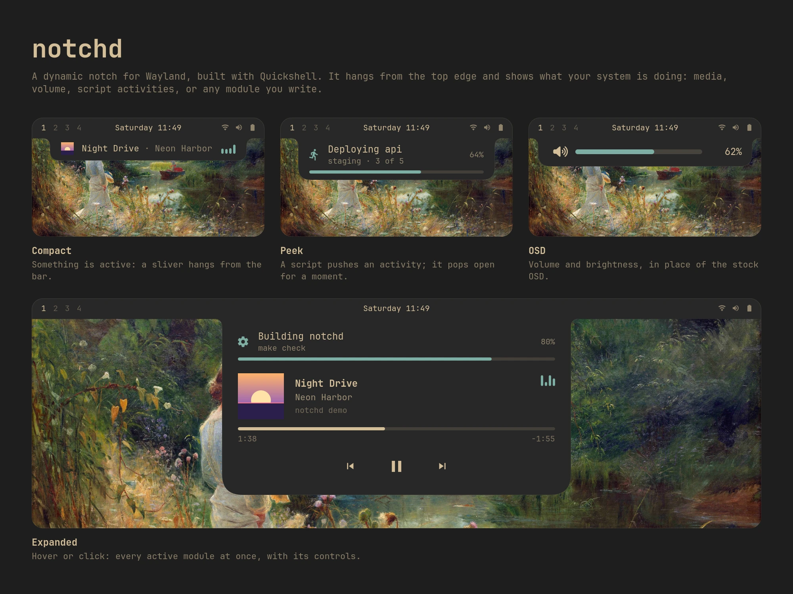

# notchd



A dynamic notch for Wayland desktops, built with Quickshell. It hangs from the top edge of the focused screen and shows modules: media, OSD, script activities, or anything you write.

It is a **notch framework, not a shell**. Modules show what the system is already doing; they never take over a system service. The notch is not a notification daemon, a launcher or a lock screen, so it sits on top of whatever desktop you already have.

## Install

notchd runs inside a *host*: the desktop-specific wiring around the generic core.

- **Omarchy**: the repository is an Omarchy shell plugin (`eryk.notchd`), with volume/brightness OSD and the compact view in the bar. See [hosts/omarchy](hosts/omarchy/README.md).
- **Any other Wayland compositor with layer-shell**: the repository is also a standalone Quickshell config (`qs -p <checkout>`). See [docs/standalone.md](docs/standalone.md).

## States

| State | When | Shows |
|---|---|---|
| rest | nothing active | a small lip (nothing in bar style) |
| compact | a module is active | the highest-priority active module's `compact` view, or its `barView` in the host's bar |
| peek | a module calls `requestPeek()` | that module's `peek` view, for a few seconds |
| expanded | hover (click pins it, click outside unpins) | the `expanded` view of every active module |

Over a fullscreen app only peeks show.

`compactStyle` in the config sets where compact lives:

- `"bar"`: in the host's bar indicator. The notch only drops out to peek or expand. Only hosts with a bar indicator support it; that is only the Omarchy host today.
- `"notch"`: compact hangs from the top edge all the time, Mac style.

A hanging notch covers the top of the windows under it. `reserveSpace: true` keeps windows below it instead: the compositor reserves a strip as deep as the closed notch, across the whole width of every screen (layer-shell can only reserve whole edges). At rest that is the thin lip; while a module is active, a compact notch's height. It grows at once and shrinks a few seconds after the module ends, so windows move when music starts or stops or an activity comes and goes, not for peeks: volume, brightness and the expanded notch open over windows. It does nothing in `"bar"` style.

`workspaces` limits where the closed notch shows, e.g. `[1, 2, 3]` (ids or names). When the focused screen shows another workspace, the closed notch moves to a screen that shows one of them, or hides if none does; in `"bar"` style the bar indicator hides on those screens. Peeks and the open notch still show on the focused screen, so the volume OSD never goes missing. Reserved space follows too: a screen showing a workspace without the notch reserves nothing, so switching a screen between the two moves its windows. It needs a compositor adapter that knows workspaces (Hyprland today).

## Config

The config lives in `$XDG_CONFIG_HOME/notchd/config.json` (usually `~/.config/notchd/config.json`), outside the source tree, so plugin updates never touch it. A missing file means every key is at its default. A file you create by hand is picked up within a couple of seconds, and edits apply live.

| Key | Default | |
|---|---|---|
| `modules` | `["media", "activities"]` | module ids to load, in order |
| `compactStyle` | `"bar"` | see above |
| `hoverOpenDelay` | `120` | ms |
| `hoverCloseDelay` | `300` | ms |
| `reserveSpace` | `false` | keep windows below the closed notch (`"notch"` style); see above |
| `workspaces` | every one | workspaces the closed notch shows on; see above |

Hosts add their own keys; the standalone host, for example, adds `topOffset` and `theme`. A key missing from the file falls back to its default.

## Settings

The gear in the expanded notch (or the `settings` IPC method) opens the settings window: a sidebar of pages, and on each page its fields grouped by section. Every change applies at once and is written back to the config file; there is no Apply button. Clearing a field removes the key, so it goes back to its default. Ctrl+Tab cycles pages; Esc closes.

## IPC

Scripts drive the notch through Quickshell IPC: push an activity, open the notch, change a config key. See [docs/ipc.md](docs/ipc.md).

```sh
omarchy-shell eryk.notchd push '{"id":"deploy","title":"Deploying api","progress":40,"sticky":true}'
```

## Documentation

- [docs/modules.md](docs/modules.md): writing a module
- [docs/standalone.md](docs/standalone.md): the standalone host
- [docs/hosts.md](docs/hosts.md): what a host provides, for porting notchd to another desktop
- [docs/settings.md](docs/settings.md): the settings schema, pages and controls
- [docs/theming.md](docs/theming.md): theme tokens
- [docs/ipc.md](docs/ipc.md): IPC methods
- [DEVELOPMENT.md](DEVELOPMENT.md): working on notchd itself
- [CHANGELOG.md](CHANGELOG.md)

## License

MIT, see [LICENSE](LICENSE). The Omarchy host's `osd` module adapts code from Omarchy, which is also MIT; see [NOTICE](NOTICE).
